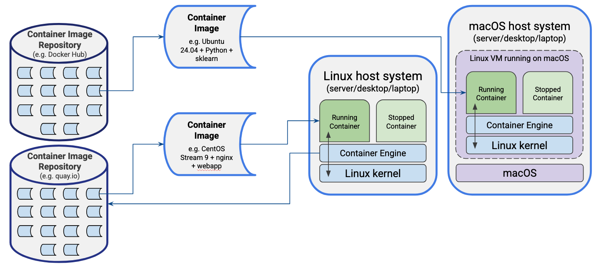

:::::::::::::::::::::::::::::::::::::: questions 

- What are containers and how do they differ from virtual machines?
- Why are containers useful for research software and reproducibility?
- How do containers work under the hood?
- How are containers deployed on Linux versus macOS or Windows?
- What container engines and platforms are commonly used?

::::::::::::::::::::::::::::::::::::::::::::::::

::::::::::::::::::::::::::::::::::::: objectives

- Explain what containers are and how they differ from virtual machines.
- Describe the key benefits of using containers for research software development and reproducibility.
- Identify the Linux technologies that underpin container isolation.
- Explain the role of container images, layers, and writable container filesystems.
- Describe how containers are deployed differently on Linux versus macOS and Windows.
- Name common container engines and orchestration platforms and their typical use cases.
- Explain what Podman is and why it is used in this lesson.

::::::::::::::::::::::::::::::::::::::::::::::::

Containers have become a standard approach for developing, testing, deploying, and distributing modern software.
A container approach packages an application together with its libraries, dependencies, and runtime environment into a single, portable virtual machine-like package (or *container image*) that runs consistently across different systems.
Unlike virtual machines however, containers share the host operating system, making them lightweight, fast to start, and efficient to run. They simplify software deployment by ensuring that applications behave the same on a developer's laptop, a testing environment, and in production, which reduces the common problem of "well, it works on my machine".

## Why use Containers?

Reasons for using containers includes:

- *Application Portability*: containers package an application with everything it needs to run, allowing it to be moved easily between laptops, servers, cloud platforms, and high-performance computing systems. This helps ensure consistent behaviour regardless of the underlying infrastructure.
- *Reproducibility*: containers capture the complete software environment, including specific versions of operating system libraries, dependencies, and tools. This makes it much easier to reproduce computational results and rerun analyses months or years later.
- *Ease of deployment*: by bundling dependencies within the container, applications avoid many common installation problems caused by missing libraries or incompatible software versions. This simplifies installation and reduces the time spent configuring systems.
- *Security*: since containers isolate applications and resources such as processes, and memory from one another and from the host system, this reduces the impact of faults or compromised services. They are widely used to host web applications, databases, and other services in isolated environments.
- *Large library of existing containerised software:* thousands of ready-to-use container images are freely available from public registries such as Docker Hub and the GitHub Container Registry. This allows developers and researchers to deploy complex software quickly without building environments from scratch.
- *Container orchestration*: platforms such as Kubernetes automate the deployment, scaling, networking, and management of containers across multiple machines, which is useful for building scalable applications that can adapt to changing workloads.

## How do Containers Work?

### Linux as an Enabling Technology

Linux is fundamental to how most containers work because containers are a Linux operating system feature rather than a form of virtual machine.
Unlike virtual machines, which emulate hardware and run a complete guest operating system, Linux containers share the host's Linux kernel. 
This sharing is what makes containers fast to start and efficient in their use of memory and CPU.

Two key Linux technologies enable this capability:

- *Namespaces* isolate resources such as processes, users, filesystems, networking, and hostnames, so each container appears to have its own independent system.
- *Control groups (cgroups)* limit and monitor the resources a container can use, such as CPU time, memory, disk I/O, and network bandwidth.

Together, namespaces and cgroups provide the isolation and resource management that containers require, while the shared kernel eliminates the overhead of running multiple operating systems.
This of course means you need a bridging technology to run containers on operating systems other than Linux, which we'll cover shortly!

### Images

Containers are created from container images, which provide a complete template for an application's execution environment.
An image typically contains a minimal base operating system together with any required libraries, dependencies, as well as the application software you actually wish to run.
Public image repositories now host a vast range of pre-built images, making it easy to deploy many common applications with minimal effort.
As with any software download, it is important to use trusted sources, such as official operating system images or images published by the application's developers.

When deploying your own software, a common approach is to start from a trusted base operating system image, install and configure your application, and then save the result as a new reusable image which you can run anywhere.
Depending on the container technology, an image may be stored either as a single bundled file containing the entire environment or as a collection of layered files linked together by a manifest, with different image formats supporting different storage approaches.

### Container File Systems

Containers use a combination of read-only image layers and a writable container layer managed by the container runtime.

When a container starts, its image provides a stack of read-only filesystem layers containing the operating system, libraries, and application software.
The runtime adds a thin writable layer on top, and any files created or modified by the container are stored in this writable layer, while unchanged files continue to be read from the underlying image layers.
This layered approach allows many containers to share the same image on disk, reducing storage requirements.

By default, the writable layer is transient: if the container is deleted, any data stored only in that layer is lost.
For persistent data containers typically use separate volumes or alternatively, bind mounts, which map directories from the host filesystem into the container.
This allows data such as databases, configuration files, and user-generated content to persist beyond container restarts.

Internally, the container runtime uses the Linux filesystem to present the combined image layers and writable layer as a single, unified filesystem.
To applications running inside the container, this appears as a normal Linux filesystem, even though the data may be spread across multiple locations on the host.

### Managing Containers

Containers are managed by a container runtime or engine, which is responsible for creating containers from images as well as starting, stopping, and removing containers. 
The runtime also provides each container with access to resources such as the filesystem, networking, storage, and CPU and memory, while maintaining isolation from other containers and the host system.
Most users interact with the runtime through a command-line tool or graphical interface to download images, configure containers and manage their lifecycle.

### Typical Deployments

Let's look at how containers are typically deployed on two common operating systems.

In this depiction we have the two operating systems Linux and MacOS, each either installed on a server, laptop or desktop machine,
with each running an installed container "engine" which is essentially the software required to manage and run containers.
However in each case they run differently:

- For the Linux machine, since the containerisation technologies of namespaces and cgroups are native to the operating system, the container engine is able to run natively on the machine, interacting directly with the host's Linux kernel.
- For the MacOS (or Windows) machine, the host system needs to run a Linux virtual machine within which the containers run, since these technologies are not natively supported in the host system. However, despite some additional required set up, the process of interacting with and managing the containers appears largely the same as we'll see later.

Beyond this difference, in each case they have one actively "running" container, and one which has been placed into a "stopped" state,
with the running container directly interfacing with the Linux kernel through system calls (restricted through namespaces, cgroups, and controlled filesystem access), avoiding any inefficient virtual machine-level translation required by VMs.

In the case of the MacOS system, we can see the running container image is baed on Ubuntu, with Python and scikit-learn (a machine learning library) installed on it, with the image having been downloaded and installed from the Docker Hub container image repository.
The Linux system however has a CentOS operating system and a web application running under the NGINX web server, with that image coming from a different container image repository - quay.io in this case.

### Deployment Process

In general, a typical process of obtaining an image and running it is as follows:

1. A suitable image is selected from a browsable and trusted container repository (either a public one or a privately hosted container registry).
1. Using a command line or desktop container management tool the image is *pulled* from the container registry onto the local machine.
1. The container runtime retrieves the image manifest and downloads the filesystem layers it doesn't already have, storing them in a local cache of layers.
1. The new container is created based on the image and adds a writeable filesystem layer above the image's read-only layers.
1. Any command-line options or configuration files such as container name, environment variables, storage volumes, and port mappings are applied to the container.
1. The container is then started, from a preconfigured entry point or command as a Linux process.
1. The container is managed through the container runtime, in terms of inspecting, stopping, restarting, or removing it, or otherwise interacting with it.

## Common Container Engines/Platforms

Some common container engines/platforms include:

- [Docker](https://www.docker.com/) - probably the best known and most widely used container platform at present.
- [Podman](https://podman.io/) - a free and open source container engine/platform - we’ll look at this today.
- [Apptainer](https://apptainer.org/) (Singularity) - an open source, daemonless container engine - widely used in research HPC environments.
- [containerd](https://containerd.io/) - an open source container runtime that underpins other container platforms and tools.

Many more advanced uses of containers rely on orchestration platforms, for example:

- [Kubernetes](https://kubernetes.io/) (K8s)- widely-used container orchestration engine
- [K3s](https://k3s.io/) - lightweight Kubernetes implementation
- [Rancher](https://www.rancher.com) - a high-level kubernetes management platform
- [SwarmKit](https://github.com/moby/swarmkit) - Container orchestration layer used in Docker

## Podman

For today's session we will use Podman, a free and open source container engine for building, running and managing containers.
While Podman can be used entirely from the command line, Podman Desktop provides a graphical interface for managing Podman containers as well as containers created by other compatible container engines.
One of Podman's distinguishing features is its daemonless design: unlike some container engines such as Docker that rely on a continuously running daemon with root privileges, Podman launches containers directly as needed, improving security and reducing background system overhead.
Podman is also the default or recommended container engine on several enterprise Linux distributions, including Red Hat Enterprise Linux, Fedora, and CentOS Stream, making it relevant for many production and HPC environments.

On Linux, Podman runs natively using the host operating system.
On macOS and Windows, as we described earlier, it operates through a lightweight virtual machine known as a Podman machine, which provides a Linux environment while allowing users to interact with containers through familiar native command-line tools and the Podman Desktop interface.

In this session we will use Podman's command-line interface to introduce the core concepts and functionality of container management rather than the graphical Podman Desktop application.
You will learn how to search for and retrieve images from common container registries, as well as how to create, run, inspect, and manage containers based on those images.

Although the examples use Podman, the commands are almost identical when using Docker—typically requiring only the replacement of `podman` with `docker` at the start of each command.
This makes the skills covered readily transferable between the two container platforms.

::::::::::::::::::::::::::::::::::::: keypoints

- Containers package an application with its dependencies into a portable, self-contained unit that runs consistently across different systems.
- Unlike virtual machines, containers share the host's Linux kernel, making them lightweight and fast to start.
- Linux namespaces and cgroups provide the isolation and resource control that containers rely on.
- Container images are built from read-only layers; a thin writable layer is added at runtime and is lost when the container is removed (although there are options for filesystem persistence).
- On MacOS and Windows, containers run inside a lightweight Linux virtual machine managed by the container engine.
- Podman is a daemonless, open source container engine whose commands are largely interchangeable with Docker.

::::::::::::::::::::::::::::::::::::::::::::::::
